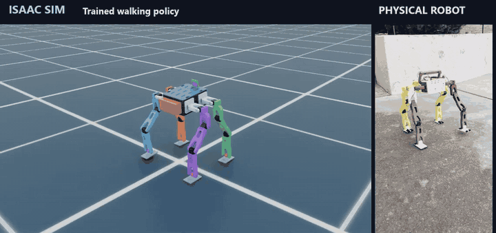
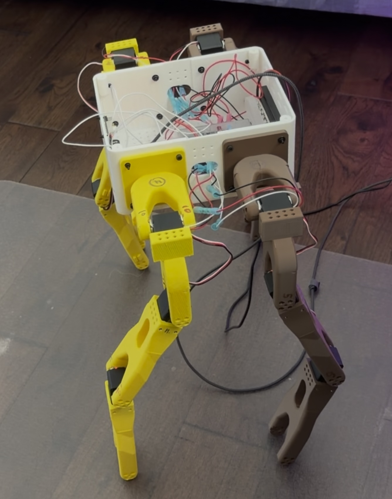

# drobot2

Monorepo for the Drobot2 robot. Engineering areas are separated at the
repository root so CAD, simulation, hardware control, and electrical design
can evolve without sharing one package boundary.

The [September 21 diagonal walking model](simulation/docs/rl-ankle-v27-overnight.md)
includes checkpoint 2549, its actor export, the approved fallback, simulation
videos and the hardware handoff. A matching Pi controller is still required.

## Sim-to-real walking demo

A walking policy trained in NVIDIA Isaac Sim, demonstrated in simulation
and on the physical Drobot2 robot.

[Download the side by side MP4](docs/media/sim-to-real-walking.mp4?raw=true)
or download the full original clips:
[Isaac Sim (V30)](docs/media/isaac-sim-v30-walking.mov?raw=true) ·
[Physical robot](docs/media/physical-robot-walking.mov?raw=true).

The comparison shows simulator policy playback and a physical robot trial
at their original speed. It ends with the shorter simulator clip (15.9 seconds);
the full physical recording is 23 seconds.

## Physical robot reference

- Measured total assembled robot mass: approximately **3.18 kg** (converted
  from a 7 lb measurement), including the installed rear battery and its
  enclosure as configured on 2026-08-23.

Treat this as the current whole-robot measurement. Component-level CAD and
simulation mass ledgers may differ and should be reconciled against it when
preparing the next dynamics-model or RL-training revision.

## Project areas

- [`cad/`](cad/README.md) — parametric mechanical design,
  CAD-derived URDF generation, manufacturing exports, vendor geometry, and CAD
  review tooling.
- [`simulation/`](simulation/README.md) — Isaac Sim integration, reinforcement
  learning, trained policies, simulator exports, evaluation media, and
  simulation documentation.
- [`hardware/`](hardware/README.md) — one-leg commissioning and four-leg
  hardware control/test applications.
- [`onboard/`](onboard/README.md) — ROS 2 Raspberry Pi runtime, LAN browser
  control, ROS services/topics, and boot-service setup.
- [`electrical/`](electrical/README.md) — power distribution, fusing, wiring,
  schematics, BOM, and power-budget planning.

Run domain-specific commands from the repository root unless that area's
README says otherwise. Shared architecture and repository conventions are
indexed under [`docs/`](docs/README.md). Generated caches and local
environments remain ignored.
