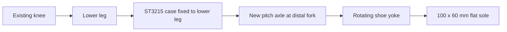

# V2 pitch ankle: running feasibility and concept

Date: 2026-09-11. Status: **local, unverified kinematic and mass concept**.
Three standalone URDFs were authored. No printable bracket/STEP, validated
simulator asset, trained policy or measured speed improvement is claimed.

September 12 updates: the separately authorized
[three-design PPO pilot](../../simulation/docs/rl-ankle-v2-training-20260912.md)
completed; it did not demonstrate an active-ankle speed advantage. A subsequent
request to show the robot produced a local
[visual review with overview and ankle close-up](../reviews/ankle-v2-20260912/README.md).
The review highlights the added motors in purple and hides the fixed cradle
envelopes for visibility. The design URDF and its physical geometry are unchanged;
mechanical fit remains unverified. The original authoring record below is dated
September 11.

The subsequent [printable V2.1 kit](ankle-v2-printable.md) replaces the lower
leg with two ST3215 sockets and uses adjustable, bolted metal-horn cheeks.
It is a separate physical prototype revision, not a claim that the original
gold envelopes were ready to print or that the pilot policies match it.

An extra pitch ankle is worth comparing because it lets the flat shoe rotate
independently of hip and knee. The strongest reason to try it is better foot
orientation and release during a stride. The strongest reason it may fail is
the extra distal mass on a robot already limited by loaded actuator response.
The expected sign of the net speed change is currently unknown.

## Evidence from this robot

The [current shoe](rectangular-fork-shoe.md) has a 100 x 60 x 6 mm flat PLA
sole. The [existing walking source](../../simulation/isaac/rl/parallel_walking/commanded_walking_env_cfg.py)
uses equal-and-opposite hip/knee angles to keep the distal link and rigid shoe
vertical. In sagittal motion, two joints therefore have to control foot
position while also satisfying a foot-angle preference. An ankle adds the
third independent coordinate. One pitch ankle does not independently correct
foot roll or solve lateral balance.

The [V44 record](../../simulation/docs/rl-flat-contact-hardware-matched-v44.md)
reports roughly 25-degree front sole tilt in the preceding reference. The
[September 5 recorded-data analysis](../../debug/walk-trials/20260905T193441588801Z-2a2a9832/actuator-constraints/README.md)
finds front-joint phase-equivalent lags around 0.31 s at approximately 1.375 Hz,
with reduced amplitudes. These are coupled robot observations, not identified
300 ms firmware delays. An ankle could relieve the orientation constraint;
it cannot remove the existing hip/knee tracking problem.

Published evidence supports the hypothesis only indirectly. An
[ankle comparison on a supported biped](https://arxiv.org/abs/2105.10764)
reported greater optimized walking speeds, including physical experiments;
this is neither a quadruped running result nor a prediction for Drobot.
[MIT's actuator-design research](https://fab.cba.mit.edu/classes/865.18/motion/papers/mit-cheetah-actuator.pdf)
emphasizes low leg/actuator inertia and impact handling for dynamic locomotion.
Together these motivate a controlled comparison instead of assuming that
another degree of freedom makes the robot faster.

## Mechanical concept

Assumption: one additional motor **on each foot**, so four additional motors
and 16 actuated joints in the active robot. Use the existing ST3215 variant
for the first model, without substituting the HS or STS3212 variant.



The ankle pivots at the existing distal fork-axis datum, 159.896689 mm from
the knee. The case points upward toward the knee; the output rotates a shoe
yoke. The opposite side of the axle should be bearing supported so the
gearbox output is not the only structural support. This is a proposed
mechanical arrangement, **not an established bolt-on fit**.

Retain the existing 24 mm gap from pivot to upper sole, 6 mm plate and
1 mm tread for the first comparison. These dimensions isolate ankle mobility
without also changing foot area or leg height. Packaging may later require a
different height; if so, update the locked control to match it.

The concept assumes +/-35 degrees of pitch travel and initially limits ankle
targets to 100 deg/s. Limits remain provisional until the foot sweep, cable
route, output horn, bearing and fastener interfaces are designed. The servo
case is represented by the existing exact catalog visual; gold cradle/yoke
boxes are conspicuous packaging envelopes. They do not specify a printable
cavity, wall thickness, shaft fit, horn pattern or collision-free bracket.
Future printable parts must reuse the existing ST3215 motor-bay cavity source.

The [step.parts exact ST3215 record](https://api.step.parts/v1/parts/waveshare_feetech_st3215_servo)
was queried for this task and returned the same catalog SHA-256 already in
the [vendor ledger](../vendor/README.md):
`29954eb73bd22b3f9536de2c1d8f96843b5c5b32288a8f4cb09709b8b892e39b`.
The existing immutable servo and visual mesh were reused. No new vendor model
was downloaded. The mass/torque/speed assumptions below come from the local
[servo/URDF ledger](../specs/quadruped-urdf-ledger.md); the vendor product pages
could not be retrieved during this investigation.

## What the added joint costs

The [saved closed-form calculations](../specs/ankle-v2-calculations.json)
give the following screening estimates. They are not simulation results.

| Quantity | Estimate and implication |
| --- | --- |
| Four extra 55 g motors | +220 g before any mounting hardware |
| Mounting allowance | 15 g fixed cradle + 10 g rotating yoke per foot; unmeasured |
| Complete V2 allowance | +320 g, about 10.1% over the 3.18 kg baseline; V2 about 3.50 kg |
| Added knee swing inertia | Motor alone: about 0.00141 kg m² per leg using mL²; complete 80 g allowance about 0.00205 kg m². Exact model uses separate component COMs. |
| Toe-edge ankle moment with two equally loaded stance feet | 3.50 x 9.80665 / 2 x 0.050 = 0.858 N m |
| Same edge moment at twice static vertical load | 1.716 N m, before tangential ground force and foot acceleration |
| Rate to cancel a 25-degree-amplitude sinusoid at 1.375 Hz | 2 pi x 1.375 x 25 = about 216 deg/s |
| Maximum sinusoid amplitude at 100 deg/s and 1.375 Hz | About 11.6 degrees |

The toe-edge calculation is a worst-edge lever-arm example, not the required
moment at every flat-foot contact: a centered ground reaction has a much
smaller pitch lever arm. Nevertheless, 0.858 N m leaves little margin under
the study's conservative 0.883 N m sustained effort cap. Stall torque is not
a continuously available push-off torque. The sinusoid calculation assumes
25 degrees is an amplitude; the recorded tilt is not proof of that waveform.
It illustrates why adding another equally slow servo may still fail at a
fast cadence.

## Files and coordinate contract

| File | Purpose |
| --- | --- |
| [Rigid baseline](../exports/urdf/quadruped_robot_v2_ankle_baseline.urdf) | 12 movable joints, four fixed feet, nominal 3.18 kg |
| [Weighted locked ankle](../exports/urdf/quadruped_robot_v2_ankle_locked.urdf) | Same V2 mass/geometry with mechanically fixed ankles, nominal 3.50 kg |
| [Active V2 ankle](../exports/urdf/quadruped_robot_v2_ankle_active.urdf) | Four new revolute ankles, 16 movable joints, nominal 3.50 kg |

These isolated URDFs are the editable robot-description sources. They copy
the existing geometry once and embed their own design ledgers; the old CAD
generator does not own them. Their source meshes and inherited transforms are
unchanged. The ordinary robot URDF, USD, training tasks and onboard policies
were not changed by this study. Keep later edits to the three comparison
models coordinated; they do not automatically track changes to the old CAD.

URDF coordinates remain SI with body +X forward, +Y left, +Z up. New foot
frames sit at distal-local (0.159896689, 0, 0) with zero relative RPY. Local
foot +X points downward at neutral. Ankle axes match the knee axes: local -Z
on left legs and +Z on right legs, giving positive toe-up rotation at
neutral on both sides. Sole collision sizes are local (0.006, 0.100, 0.060),
and their centers are local (0.027, 0, 0) from the ankle. Only the foot/yoke
rotates; the added servo and fixed cradle belong to the distal link.

The old fork-tip spheres are removed. All versions have separate foot links,
so a future importer must preserve those bodies for contact sensing. They
already contain the rear payload and shoes: do not apply the old runtime's
shoe insertion, rear-payload replacement or dry-mass scaling again.

## Mass and inertia assumptions

The legacy URDF uses fully solid PLA estimates and has no actual shoe
inertials. A common study baseline was therefore closed to **3.18 kg** rather
than adding ankles to that heavier provisional robot. The old centered
450 g battery is replaced by a separate 523.179545 g rear assembly at the
existing runtime's assumed location (-0.1315, 0, 0.050) m.

Known 55 g servo masses, sensor/camera masses, the 150 g electronics allowance,
rear payload and four 70.237 g shoe estimates are preserved. The remaining
estimated dry material is scaled by 0.46683445139437 to close the baseline
mass. Components are subtracted/recombined with the parallel-axis theorem;
box inertias use m/12 times the sum of the other two squared dimensions.
The new ankle mass is added **after** this calibration, so it cannot disappear
into a new whole-body normalization.

The whole-robot measurement fixes total mass only. This distribution, shoe
mass, electronics COM/envelope and all added bracket mass properties remain
assumptions. They differ from the existing V43/V44 physics; published V43
scores are not a directly comparable baseline for these models. Exact input
values and resulting inertials are retained in the calculation JSON.

## Reproduction and work not run

The deliverables were authored as XML using the existing URDF, documented
source dimensions, catalog lookup and closed-form arithmetic. No CAD build,
URDF validator, collision sweep, snapshot, viewer server, simulation, training,
automated test or hardware access was run, following the user's verification
restriction. No hosted review was created.

A focused structural check to request separately, from repository root, is:

```powershell
& .\cad\.venv\Scripts\python.exe `
  "$env:USERPROFILE/.codex/plugins/cache/text-to-cad/cad/0.4.21/skills/urdf/scripts/validate" `
  .\cad\exports\urdf\quadruped_robot_v2_ankle_baseline.urdf `
  .\cad\exports\urdf\quadruped_robot_v2_ankle_locked.urdf `
  .\cad\exports\urdf\quadruped_robot_v2_ankle_active.urdf --strict
```

This command was not executed. Structural validity would still not establish
bracket fit or dynamic performance. The next software design is the
[RL comparison contract](../../simulation/docs/rl-ankle-v2-study.md).
